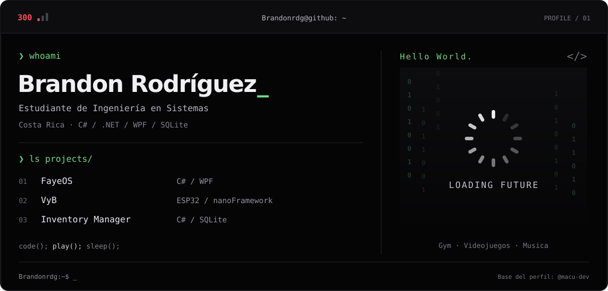

<!-- Diseño original: https:github.com/macu-dev/macu-dev -->
<!-- Perfil personalizado para Brandonrdg -->

<!-- LOCAL CITY-POP BANNER -->
<a href="https://github.com/Brandonrdg">
  <picture>
    <source media="(prefers-color-scheme: dark)" srcset="assets/banner-dark.v9.svg">
    <source media="(prefers-color-scheme: light)" srcset="assets/banner-light.v9.svg">
    
  </picture>
</a>

 

---

## `$ whoami`

  

 

## `$ cat tech-stack.yaml`

<table border="1" cellpadding="14" bgcolor="#17171c">
  <thead>
    <tr>
      <th colspan="2" align="left"><code>Brandonrdg:~$ cat tech-stack.yaml</code></th>
    </tr>
  </thead>
  <tbody>
    <tr>
      <td width="50%" valign="top"><code>├─ ☁ cloud_infrastructure:</code>  
         
        <code>AWS · Azure · Ansible</code>
      </td>
      <td width="50%" valign="top"><code>├─ ▣ databases_messaging:</code>  
        
         
        <code>Amazon RDS · MySQL · PostgreSQL · MongoDB · DynamoDB</code>
      </td>
    </tr>
    <tr>
      <td valign="top"><code>├─ ⚙ containers_ci_cd:</code>  
         
        <code>Kubernetes · Docker · GitHub Actions · GitLab CI · Bitbucket · Bash</code>
      </td>
      <td valign="top"><code>├─ ◉ monitoring_observability:</code>  
        
        
         
        <code>Sentry · Prometheus · Datadog · Amazon CloudWatch</code>
      </td>
    </tr>
    <tr>
      <td valign="top"><code>├─ ✦ languages_frameworks:</code>  
         
        <code>Node.js · JavaScript · React · Next.js · TypeScript · Python · FastAPI</code>
      </td>
      <td valign="top"><code>╰─ ⌁ security_iac:</code>  
        
        
        
        
         
        <code>Trivy · SonarQube · Terraform · Cilium · Falco</code>
      </td>
    </tr>
  </tbody>
  <tfoot>
    <tr>
      <td colspan="2"><code>status: ready&nbsp;&nbsp;·&nbsp;&nbsp;environment: production</code></td>
    </tr>
  </tfoot>
</table>

---

## `$ kubectl get signals --all-namespaces`

  <picture>
    <source media="(prefers-color-scheme: dark)" srcset="assets/radar-dark.svg">
    <source media="(prefers-color-scheme: light)" srcset="assets/radar-light.svg">
    
  </picture>&nbsp;
  <picture>
    <source media="(prefers-color-scheme: dark)" srcset="assets/radar-langs-dark.svg">
    <source media="(prefers-color-scheme: light)" srcset="assets/radar-langs-light.svg">
    
  </picture>

<code>signals: devops_skill_radar · language_stack_radar · status: healthy</code>

---

<!-- SOCIALS -->
## `$ connect --socials`

 
 

  
    Brandon Rodríguez · Costa Rica 
    Diseño original de
    <a href="https://github.com/macu-dev/macu-dev">Macu (@macu-dev)</a>
    · Personalizado para este perfil
  

