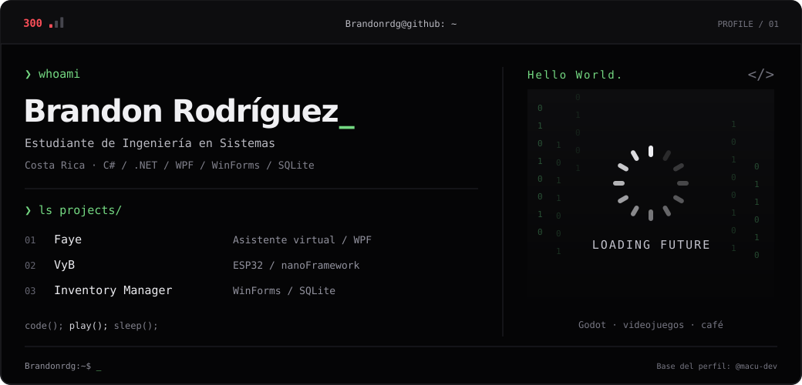
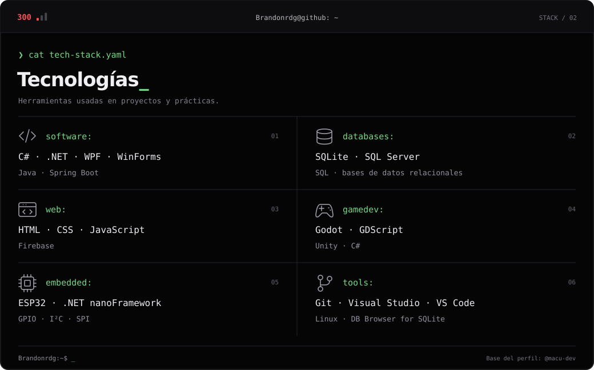
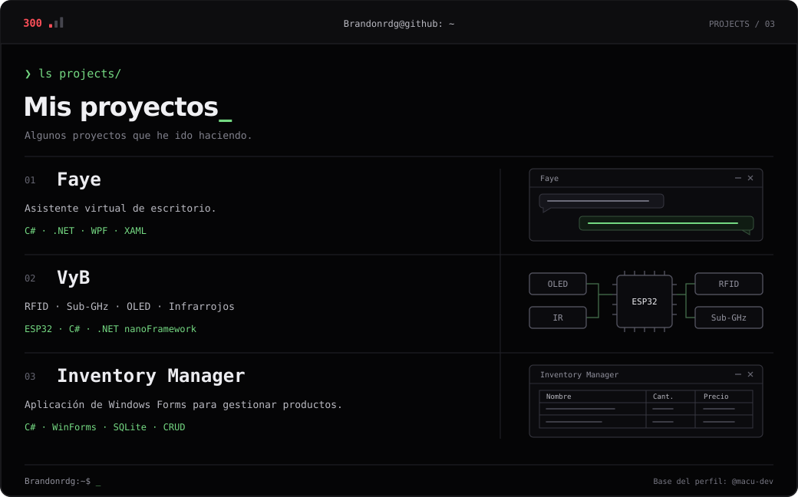
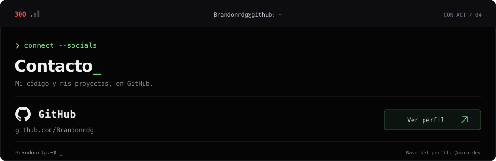

<!-- Diseño original: https:github.com/macu-dev/macu-dev -->
<!-- Perfil personalizado para Brandonrdg -->

<!-- LOCAL CITY-POP BANNER -->
<a href="https://github.com/Brandonrdg">
  <picture>
    <source media="(prefers-color-scheme: dark)" srcset="assets/banner-dark.v9.svg">
    <source media="(prefers-color-scheme: light)" srcset="assets/banner-light.v9.svg">
    
  </picture>
</a>

 

---

## `$ whoami`

  

 

## `$ cat tech-stack.yaml`

  

---

## `$ ls projects/`

  

---

<!-- SOCIALS -->
## `$ connect --socials`

  

 
 

  
    Brandon Rodríguez · Costa Rica 
    Diseño original de
    <a href="https://github.com/macu-dev/macu-dev">Macu (@macu-dev)</a>
    · Personalizado para este perfil
  

